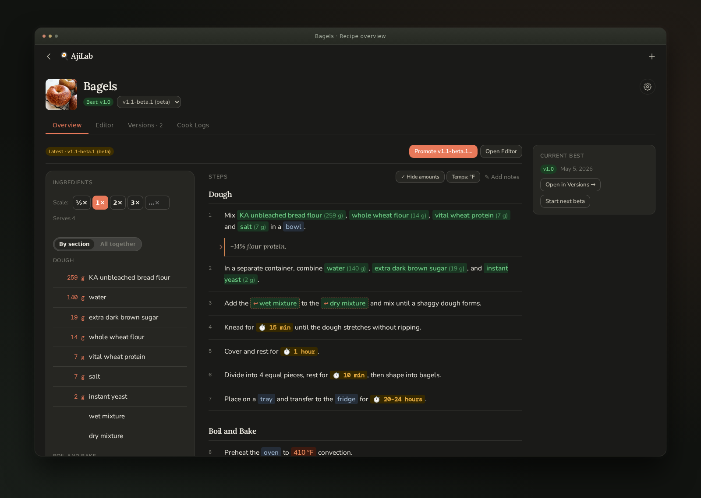
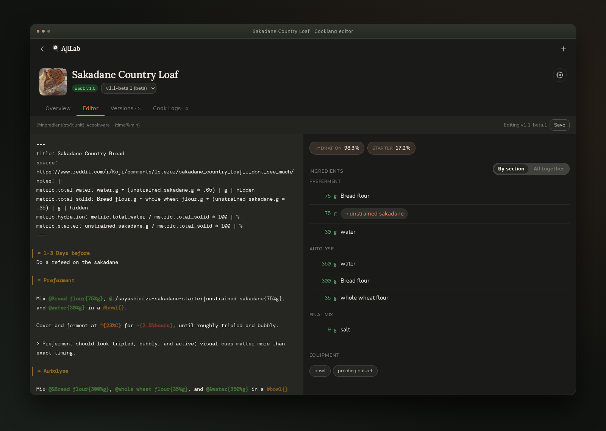
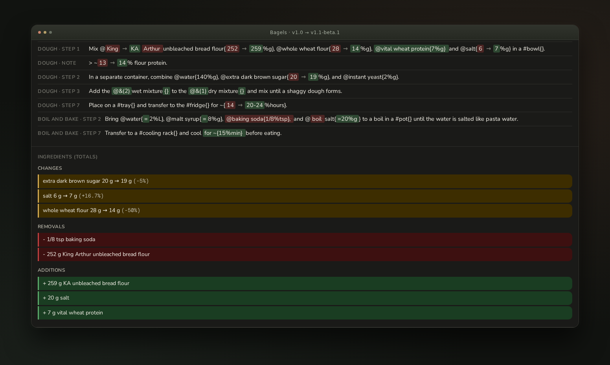

# AjiLab

A self-hosted recipe lab for people who iterate on recipes over time.

AjiLab keeps the recipe, the experiment, and the result together. Write in Cooklang, iterate through beta snapshots, record what you actually cooked, and compare changes before promoting an experiment to a named release.



*Cook from a recipe with ingredients, equipment, timers, and temperatures in context.*

[Quick start](#quick-start) · [Features](#features) · [Cooklang syntax](#writing-recipes-with-cooklang) · [Documentation](#documentation)

> **Status:** Early and changing quickly. **AjiLab is developed with AI assistance.** I am adapting it to my own workflow, so expect rough edges and frequent changes. Cooklang compatibility is a goal; AjiLab-specific extensions are described below and may render differently in other tools.

---

## Quick start

Requires **Docker with Compose**, **Git**, and **OpenSSL**. Run these commands in a shell with those tools installed:

```bash
git clone https://github.com/mcgrizzz/AjiLab ajilab
cd ajilab
echo "POSTGRES_PASSWORD=$(openssl rand -hex 16)" > .env
docker compose up -d
```

Open **[http://localhost:3000](http://localhost:3000)**.

Compose starts Postgres, the app, and the backup service. The first start installs dependencies and builds the editor bundle; follow progress with `docker compose logs -f ajilab`.

By default, the app pulls the current Git branch on container startup. Set `AUTO_PULL=false` in `.env` to manage updates yourself. See [Deployment & configuration](docs/DEPLOY.md) for configuration and local development.

---

## What AjiLab is for

Use it when you want to:

* keep a clean main recipe while testing variations
* release named recipe versions such as `v1.0`, `v1.1`, or `v2.0-beta.1`
* keep cooking notes tied to the exact version you cooked
* compare changes between drafts, releases, and cook logs
* track derived values like hydration, baker's percentages, salt percentage, or yield
* build recipes out of other recipes, such as levain, aioli, fillings, sauces, or components

---

## Features

### Versioned recipes



*Write Cooklang beside a live preview, with computed metrics and linked recipe ingredients.*

Open the **Editor** to write or continue working on a recipe. When you are happy with it, release it as a named version with an optional changelog. Old versions are preserved, so you can always review, compare, fork, or re-release earlier work.

* Write → release → iterate, as many times as needed
* Release versions such as `v1.0`, `v1.1`, or `v2.0-beta.1`
* Mark versions as `released`, `beta`, or `archived`
* Fork any old version back into the Editor to continue from there
* Snapshot the Editor as the next beta with one click (**Save as v1.1-beta.2**), with Undo; the Editor autosaves, and a beta never changes once taken

### Branches (API only for now)

Branches are created through the API; the app has no button for it yet. Once a recipe has a second branch, a branch picker appears next to the version picker, and everything else (Editor, versions, cook logs, compare) works per branch. See [API: Branches](docs/API.md#branches).

A **branch** is for a fundamentally different direction that shouldn't disturb the main recipe.

Examples:

* a dairy-free version
* a different technique
* a scaled-up catering version
* a lower-hydration test dough
* a separate fermentation schedule

Each branch has its own independent Editor and version history, forked from a chosen starting version. When needed, you can sync changes back from main with a 3-way merge.

### Cook logs

After cooking, log the session against any version or current work-in-progress. A cook log records what happened in the real world, including the outcome, problems, adjustments, and ideas for the next test.

Each log also stores an editable copy of the recipe text as you actually made it, because the cooked version often differs from the official recipe.

Cook logs can be:

* reviewed later as experiment history
* compared against the current Editor or any release
* forked back into the Editor
* promoted directly into a new release

### Compare

Compare any two versions, cook logs, or the current Editor.

AjiLab provides more than a plain text diff:

* **Ingredient diff** — unit-normalized, so `500 g` and `0.5 kg` are treated as equivalent
* **Step diff** — grouped by Cooklang section headers such as `= Dough` or `= Bake`; steps are matched by similarity, so an inserted step shows as added instead of shifting every step after it
* **Inline diff** — character-level highlights inside changed lines



*Compare a release with its next beta to see what changed in the method and ingredient totals.*

### Computed metrics

Define derived values in recipe frontmatter: hydration, baker's percentages, salt percentage, yield, or anything else that can be calculated from ingredient quantities.

```yaml
---
metric.hydration:  100 * water.g / flour.g | %
metric.salt pct:   100 * salt.g / flour.g  | %
---
```

Metrics display alongside the recipe and update live as ingredient quantities change in the editor.

### Recipe cross-references

Use one recipe as an ingredient in another recipe.

```cooklang
Use @./levain{50%g} in this dough.
Add @./aioli/v1.2{} to serve.
```

AjiLab resolves references to the latest released version unless you pin a specific version. It can also show linked recipes inline and maintain backlinks, so every recipe knows which other recipes depend on it.

### Images

Attach images to:

* a recipe
* a specific version
* a cook log

Set a thumbnail per recipe. Images are stored in Postgres, so there is no separate upload directory to manage or back up.

### Search

Search across recipe titles, content, and tags from the recipe list.

### Cooking and printing

Scale ingredient quantities, switch between section groups and combined totals, show or hide amounts in the steps, and convert displayed temperatures between °F and °C. Open the print view from a recipe with **Ctrl+P** / **⌘P** for a printable recipe at the selected scale.

---

## Writing recipes with Cooklang

Recipes are written in [Cooklang](https://cooklang.org), a plain-text recipe format. Use YAML frontmatter for metadata.

<details>
<summary>Syntax guide and AjiLab extensions</summary>

```cooklang
---
servings: 4
notes: |-
  Adapted from Grandma's notebook, p. 47.
---

Melt @butter{100%g} in a #saucepan{}.
Add @flour{2%tbsp} and whisk for ~{2%minutes}.
Pour in @milk{500%ml} gradually.
Season with @salt{} and @pepper{}.
Bake at ^{200%C} until golden.
```

| Syntax                  | Meaning                                                          |
| ----------------------- | ---------------------------------------------------------------- |
| `@ingredient{qty%unit}` | Ingredient with quantity                                         |
| `@ingredient{}`         | Ingredient with no quantity                                      |
| `#cookware{}`           | Cookware item                                                    |
| `~{qty%unit}`           | Timer                                                            |
| `^{value%unit}`         | Temperature (AjiLab extension); supports ranges                  |
| `>> key: value`         | Inline metadata, as an alternative to frontmatter                |
| `= Section Name`        | Section header used to group steps and drive section-aware diffs |

### Ingredient annotations

AjiLab supports additional ingredient annotations for optional ingredients, hidden ingredients, repeated references, and intermediate preparations.

| Syntax               | Meaning                                                             |
| -------------------- | ------------------------------------------------------------------- |
| `@?ingredient{}`     | Optional ingredient, flagged in the UI                              |
| `@-ingredient{}`     | Hidden ingredient, counted in totals but not listed normally        |
| `@&ingredient{}`     | Reference to an earlier ingredient with the same name; totals merge |
| `@&(=1)ingredient{}` | Intermediate from section 1; shown where it is consumed             |

### Temperatures

Write temperatures with the `^{value%unit}` sigil. This is an AjiLab extension; standard Cooklang renderers fall back to showing it as plain text.

```cooklang
Preheat the #oven{} to ^{200%C}.
Roast at ^{180-200%C} until the core reaches ^{74%C}.
```

| Syntax          | Meaning                            |
| --------------- | ---------------------------------- |
| `^{200%C}`      | A single temperature               |
| `^{180-200%C}`  | A temperature range                |
| `^{350%F}`      | Fahrenheit                         |

* The unit can be `C`, `F`, `°C`, `°F`, or the spelled-out `celsius` / `fahrenheit`.
* The viewer's **°F / °C** toggle converts displayed temperatures on the fly, including both ends of a range.

### Metrics

Add `metric.<name>: <formula> | <unit>` keys to the frontmatter to compute derived values.

```yaml
---
metric.hydration:    100 * water.g / flour.g    | %
metric.salt pct:     100 * salt.g / flour.g     | %
metric.total:        flour.g + water.g + salt.g | g | hidden
metric.yield:        metric.total               | g
---
```

Notes:

* Reference ingredients as `name.unit`, such as `flour.g` or `water.ml`
* Use underscores for multi-word ingredient names: `whole_wheat_flour.g`
* Reference an earlier metric with `metric.<name>`
* Add `| hidden` to hide a metric from the UI while keeping it available to later formulas
* Use the `| %` or `| g` suffix to control display units

### Recipe references

```cooklang
Use @./sourdough-starter{50%g} as the levain.
Top with @./aioli/v1.2{} to serve.
```

| Pattern                  | Resolves to                                |
| ------------------------ | ------------------------------------------ |
| `@<slug>{}`              | Latest released version of that recipe     |
| `@./<slug>{}`            | Latest released version, path-style        |
| `@./<category>/<slug>{}` | Latest released version in a category path |
| `@./<slug>/v1.0{}`       | A specific pinned version                  |

</details>

---

## Data and backups

All data lives in a single Postgres database on your server:

* recipes
* drafts
* versions
* branches
* cook logs
* images

Recipe data and images are stored on your server. The web interface loads fonts from Google Fonts.

With the supplied Compose setup, backups run when the backup service starts and then daily at 02:00 in the container's timezone. Dumps are written to `./backups/`, with a default 30-day retention period. For off-site backups, configure the optional rclone sidecar in `docker-compose.yml`.

See [docs/BACKUP.md](docs/BACKUP.md) for restore instructions.

---

## Documentation

* [Deployment & configuration](docs/DEPLOY.md) — Docker, local development, systemd, and environment variables
* [HTTP API](docs/API.md) — endpoints with request and response shapes
* [Backup & restore](docs/BACKUP.md) — nightly dumps, cloud sync, and disaster recovery
